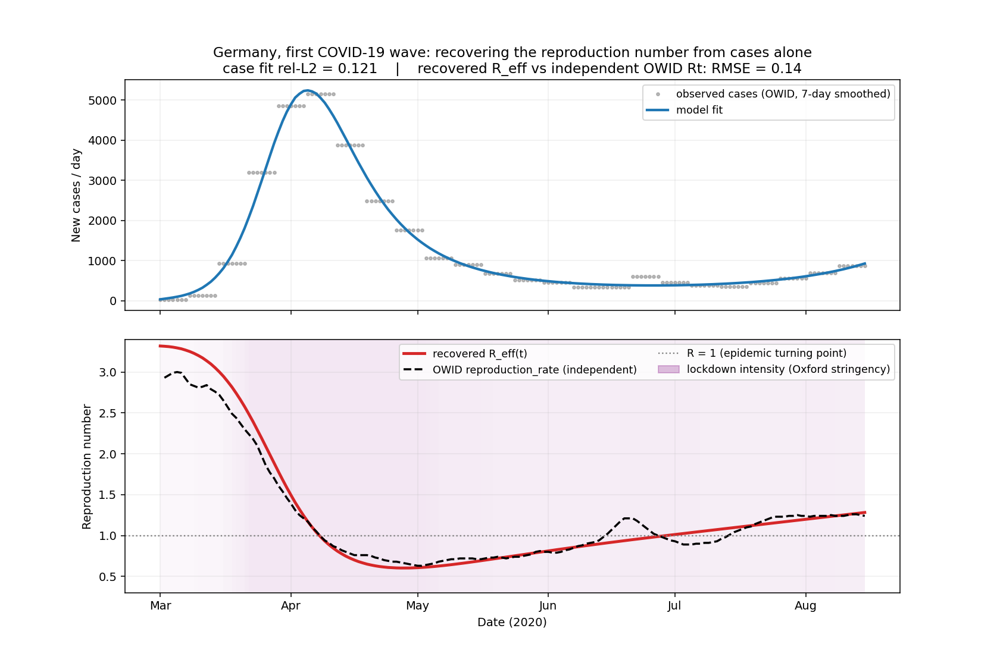

# Epidemic-PINN: recovering a hidden, time-varying transmission rate from COVID-19 data

**Can you recover the reproduction number R₀(t) of an epidemic from reported cases alone?**
This project says yes. It trains a small neural network to represent the transmission
rate β(t) of an SEIR model and fits it to real COVID-19 case data by backpropagating
**through a differentiable epidemic simulator** — recovering the hidden, time-varying
β(t), and with it the reproduction number R₀(t)/R_eff(t), as an *inverse problem*.



*Germany, spring 2020. Trained only on the case curve (top), the model recovers an
effective reproduction number R_eff(t) (red, bottom) that tracks Our World in Data's
**completely independent** reproduction-rate estimate (black dashed) to RMSE 0.14 —
crossing the epidemic turning point R = 1 on 8 April, about two weeks after the national
lockdown (shading = lockdown intensity).*

## Why this is interesting

The transmission rate is what public-health teams most want to track, and it is **never
observed directly**. We see only a noisy, scaled proxy of one compartment (reported
cases) and must reconstruct the full latent state *and* a free function β(t). That is the
sweet spot for a physics-informed approach: fit the data while the epidemic dynamics
constrain the solution.

The twist that makes it work on real data: instead of enforcing the ODE as a soft
residual penalty (a standard collocation PINN — which we tried, and which is unstable for
low-attack-rate epidemics), we **integrate the SEIR ODE with a differentiable RK4 scheme**
driven by the β-network. The physics then holds *exactly by construction* and there are no
loss weights to tune.

This repo grew out of a Navier–Stokes PINN — the same physics-informed idea, carried
from fluids into a real-world epidemiology inverse problem.

## Results at a glance

| Experiment | Result |
|---|---|
| **Synthetic recovery** of a known β(t), 5 % noise | β rel-L2 **0.026** (identifiable window) |
| **Germany first wave** vs independent OWID R_t | RMSE **0.14**; turning point 8 Apr 2020 |
| **Noise robustness** (0 → 20 %) | β error 0.027 → 0.038 (graceful) |
| **Sparsity robustness** (daily → biweekly) | β error 0.030 → 0.040 (barely degrades) |
| **vs classical growth-rate baseline** | PINN **0.027** vs baseline 0.250 (~10×) |

Full write-up with method and limitations: [`report/report.md`](report/report.md).

## How it works

- **β(t) network** (`src/model.py`): a small tanh MLP of scaled time, with a sigmoid
  output transform giving a hard positivity/boundedness constraint and an implicit
  smoothness prior.
- **Differentiable SEIR** (`src/seir.py`): a numpy RK4 integrator (ground truth / data
  generation) and a matching **differentiable** torch RK4 integrator the model trains
  through. A unit test pins the two together.
- **The fit** (`src/pinn.py`, `src/train.py`): unknowns are the β-network and the two
  initial infected fractions; loss is a scale-free case-fit term plus a β-smoothness
  penalty; optimised Adam → L-BFGS on CPU + float64.
- **Data** (`src/data.py`): loads a frozen, cached per-country slice of the Our World in
  Data COVID-19 dataset; uses the 7-day-smoothed case series and handles reporting gaps.

**Identifiability is treated honestly:** β(t) is only recoverable where infectious
prevalence is non-negligible, so every figure shades the non-identifiable region and every
error is reported on the identifiable window. See the report's limitations section.

## Repository layout

```
src/            seir.py · model.py · pinn.py · train.py · data.py   (the method)
experiments/    synthetic_recovery · headline_germany · noise_sweep · sparsity_sweep
                · baseline_comparison · explore_data                (one script per result)
tests/          test_seir.py                                        (physics correctness gate)
figures/        all generated figures (committed)
results/        metrics (.txt/.csv, committed)
report/         report.md — paper-style write-up
data/cache/     frozen OWID per-country slices  (make_slices.py regenerates them)
run_all.py      one-command reproduction
```

## Reproduce

```bash
python -m venv .venv && source .venv/bin/activate
pip install torch numpy scipy pandas matplotlib pytest

python -m pytest -q       # physics unit tests
python run_all.py         # all experiments + figures (a few minutes, CPU)
python run_all.py --quick # skip the multi-seed sweeps (the slow part)
```

## Data & method credits

Our World in Data COVID-19 dataset (frozen 2024-08-19); Oxford COVID-19 Government Response
Tracker (`stringency_index`); OWID `reproduction_rate` (Arroyo Marioli et al. 2020). Method
lineage: Raissi et al. (2019), Kharazmi et al. (2021), Millevoi et al. (2023), Gostic et
al. (2020). See [`report/report.md`](report/report.md) and [`READING_LIST.md`](READING_LIST.md).
